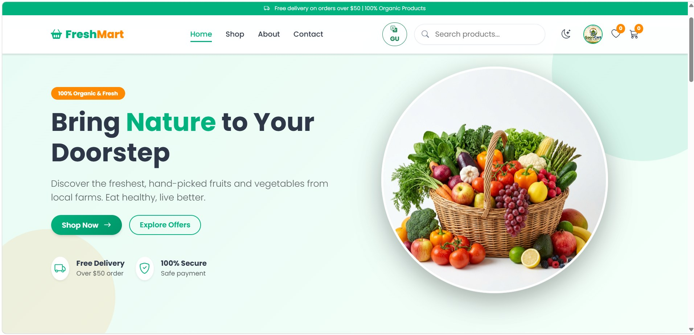
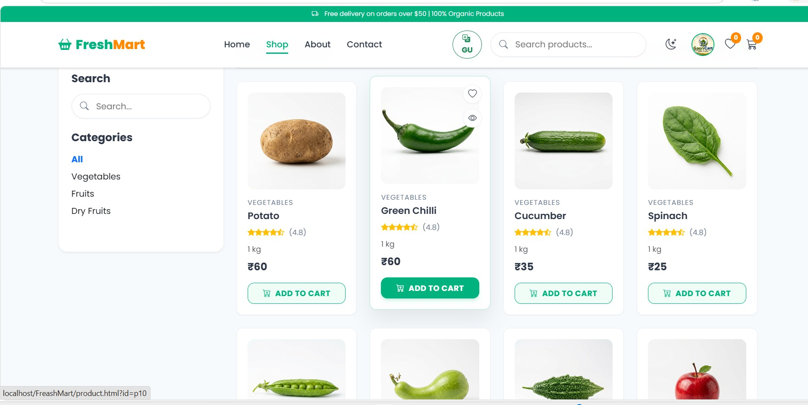
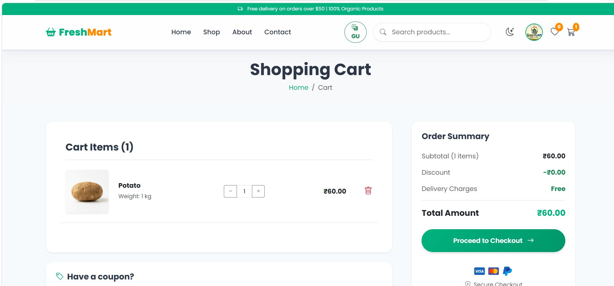
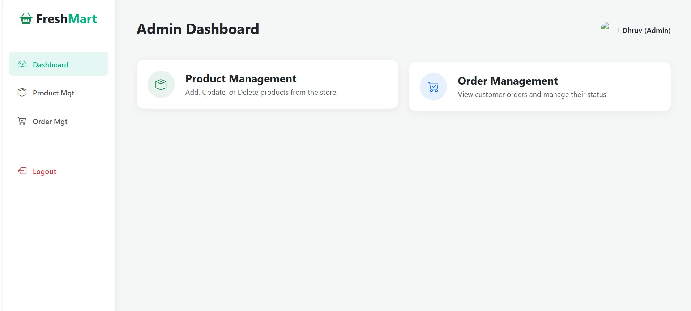
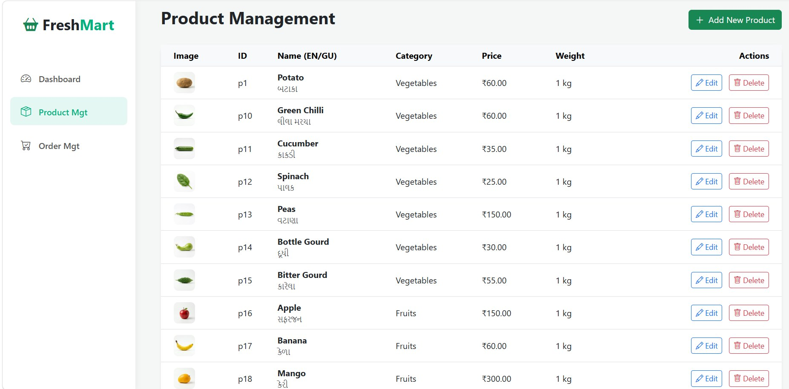
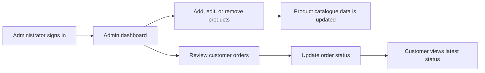

<h2> div align="center"> </h2>
  
  <h1>FreshMart</h1>
  <p><strong>Online Fruits and Vegetables E-Commerce Platform</strong></p>
  <p>Browse fresh produce, manage a cart, place orders, and maintain products through an admin panel.</p>
</div>

<p align="center">
  
  
  
  
  
  
</p>

## Project overview

FreshMart is a web application for browsing and ordering fruits, vegetables, and dry fruits. Its customer pages provide a product catalogue, search and category browsing, product details, a browser-based shopping cart, checkout, account pages, and order history. The PHP backend handles registration and sign-in, customer sessions, order submission, and administrator operations. MySQL stores customer, catalogue, and order records.

This project was developed as an academic project using WAMP Server and Visual Studio Code.

## Main features

### Customer

- Register for an account and sign in
- Browse produce by category and search products
- View product images, names, categories, prices, and weights
- Add products to a cart and change quantities
- Enter delivery information and submit an order
- View order history and order status
- Manage profile information and browse the wishlist page

### Administrator

- View the administration dashboard
- Add, edit, and delete product records
- Maintain English and Gujarati product names and categories
- Review customer orders and update order status

### Application and data

- Responsive layouts styled with Bootstrap and project CSS
- PHP sessions for signed-in customer and administrator areas
- Password hashes stored using PHP password hashing functions
- PDO prepared statements for database queries
- Browser local storage used for cart state
- MySQL records for users, products, orders, and order items

## Screenshots

| Fresh produce catalogue | Shopping cart |
|---|---|
|  |  |

| Administrator dashboard | Product management |
|---|---|
|  |  |

## Workflow

### Customer order flow


The cart is managed in the browser. When an authenticated customer submits an order, `process_order.php` writes the order and its items to MySQL in a transaction. `get_orders.php` returns the signed-in customer's order history.

### Administrator flow



## Technology stack

| Area | Technology |
|---|---|
| Frontend | HTML5, CSS3, JavaScript, Bootstrap |
| Backend | PHP |
| Database | MySQL |
| Local development | WAMP Server |
| Editor | Visual Studio Code |

## Project structure

```text
Fresh-Mart/
├── admin/                 # Static administration interface pages and styles
├── css/                   # Main site styles
├── docs/screenshots/      # README screenshots
├── img/                   # Produce and product images
├── js/                    # Catalogue data and browser interactions
├── uploads/               # Runtime profile-image uploads; keep user files private
├── admin_dashboard.php    # Admin dashboard entry point
├── admin_products.php     # Product management
├── admin_orders.php       # Order management
├── db_connect.php         # PHP database connection
├── freshmart.sql          # Initial database SQL export
├── index.html             # Store landing page
├── login.html             # Customer login page
├── register.html          # Customer registration page
├── shop.html              # Product catalogue
├── cart.html              # Shopping cart
├── checkout.html          # Checkout page
├── process_order.php      # Order submission endpoint
├── get_orders.php         # Customer order history endpoint
└── ...                    # Product, profile, wishlist, and information pages
```

## Run locally with WAMP

1. Install WAMP Server and start Apache and MySQL.
2. Copy the `Fresh-Mart` folder into the WAMP web root, usually `C:\\wamp64\\www\\Fresh-Mart`.
3. Open phpMyAdmin and import `freshmart.sql`. The SQL file creates the `freshmart` database and initial users table.
4. Configure the database connection in `db_connect.php` for your local MySQL username and password. The distributed connection file uses the usual local WAMP defaults; update them if your setup differs.
5. On a new, empty database only, run the project's one-time schema scripts in this order by opening them under `http://localhost/Fresh-Mart/`:
   - `migrate_db.php` — adds the role field, creates the product table, and loads the JavaScript catalogue data.
   - `update_db_schema.php` — adds the profile-photo field.
   - `update_db2.php` — adds the mobile field.
   - `setup_orders_table.php` — creates order and order-item tables.
6. Open `http://localhost/Fresh-Mart/` in a browser. Register a customer account, then sign in.
7. To grant administrator access to a trusted account, update that account's `role` to `admin` in the `users` table using phpMyAdmin, then sign out and sign in again.

> **Database caution:** `migrate_db.php` drops and recreates the `products` table. Use it only with a new/empty project database or after backing up data. After local setup, remove or restrict all one-time setup and migration scripts so they cannot be invoked from a public website.

## Database overview

| Table | Purpose | Typical fields |
|---|---|---|
| `users` | Customer and administrator accounts | `first_name`, `last_name`, `email`, password hash, `role`, mobile, profile photo |
| `products` | Produce catalogue | English/Gujarati names and categories, price, weight, image path |
| `orders` | Customer order header and status | order number, user ID, total amount, status, created date |
| `order_items` | Products included in an order | order ID, product ID/name, price, quantity, image path |

## Important deployment notes

- GitHub Pages serves static files and **does not execute PHP**. Use GitHub for the source code, and a PHP/MySQL-capable web host for the working application. See [GitHub Pages documentation](https://docs.github.com/en/pages/getting-started-with-github-pages/creating-a-github-pages-site).
- The checkout interface includes Cash on Delivery. A third-party online payment gateway is not integrated in this project.
- Before making a repository public, remove hard-coded demo/admin credentials and account-specific data from the original setup files. Never commit database passwords, private configuration files, or real files from `uploads/`.
- Use test accounts and test order data for demonstrations. Do not publish customers' personal information or uploaded profile photos.


No open-source license has been specified. Ask the project owners before reusing or redistributing the source code or images.
